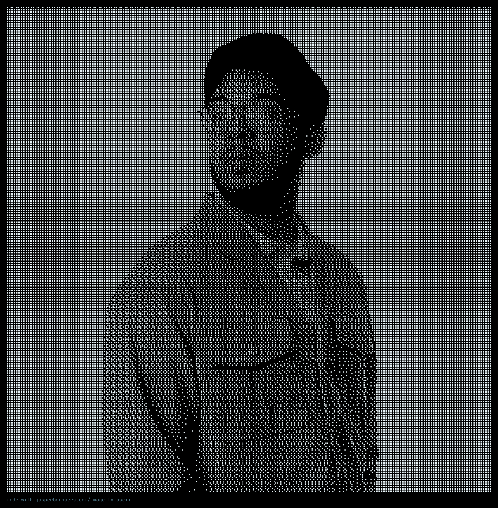

  <table>
    <tr>
      <td align="center" width="40%">
        
          
        

          <code>📍 São Paulo, Brazil</code> 
          <code>🎓 ADS @ SPTech</code> 
          <code>🌐 PT (Native) | EN (Working) | JP (Basic)</code> 
          <code>⚡ Focus: Backend & AI Agents</code>
        

      </td>
      <td width="62%" valign="top">
      <h2>Hi, I'm Matheus Ferreira! 👋</h2>
      

        Backend Developer & Systems Analysis and Development (ADS) student at <b>SPTech</b>. 
        Currently working with legacy system modernization, microservices, and autonomous AI agent architectures.
      

      <h4>⚙️ Backend & Systems</h4>
      

        
        
        
      

      <h4>🗄️ Databases & DevOps</h4>
      

        
        
        
        
        
        
      

      <h4>🎨 Frontend</h4>
      

        
        
        
        
      

      <h4>🔧 Low-Level & Legacy</h4>
      

        
        
      <h4>🤖 AI & Agent Orchestration</h4>
      

        
        
        
      

      

      <h4>📫 Connect</h4>
      

        
        
      

    </td>
    </tr>
  </table>

